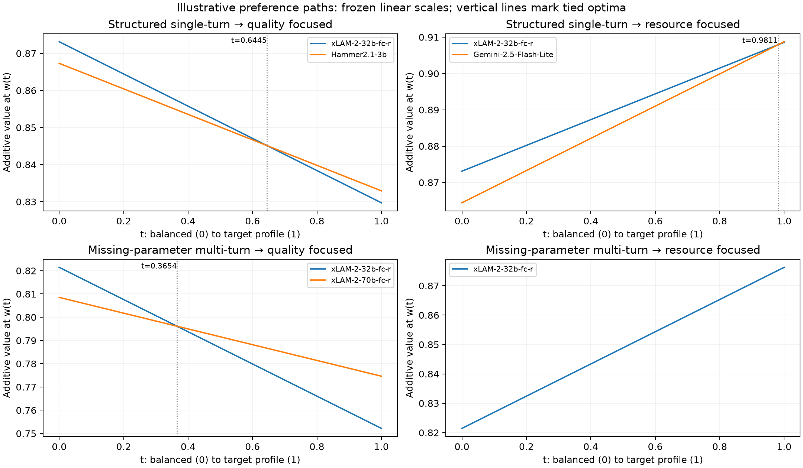

# Sensitivity analysis and preference review

Member C: scenariofour. Experiment protocol recorded on 2026-11-05 before running comparisons. All preferences and requirements remain illustrative.

## Three milestones

- [x] Specify comparisons and prepare the same private preference questions for all participants.
- [x] Run reproducible scale/extreme-observation comparisons, explain switching and infeasibility, and cross-check Member B's examples.
- [x] Verify outputs, record limitations and publish [PR #8](https://github.com/scenariofour/cee5980-ai-model-selection/pull/8) for review.

## Scope and ownership

This task owns `sensitivity.py`, `tests/test_sensitivity.py`, this document, new `results/robustness_*.csv`, `results/sensitivity_*.csv`, `results/member_c_verification.json`, and `figures/04_preference_paths.png`, with scoped handoff/changelog additions. Private questions and response records stay in ignored `deliverables/member_c/`.

Member B's [PR #7](https://github.com/scenariofour/cee5980-ai-model-selection/pull/7) is unmerged at task start. Its conditional handoff reports no arithmetic correction. This independent extension reads the baseline through `analysis.py` without editing shared code, notebook or baseline artifacts. Integration into the shared entry point waits for the reviewed handoff. Member A's [PR #6](https://github.com/scenariofour/cee5980-ai-model-selection/pull/6) is also unmerged; proposed candidate/validity corrections are not adopted here.

## Fixed experiment protocol

Use the immutable snapshot and the executable 66-row eligibility rule in [analysis.py](../analysis.py). Keep workflow and avoidance values at score/100. Keep all three [illustrative profiles](../results/summary.json), all raw consequences, and the original screen (workflow ≥60%, avoidance ≥80%, benchmark cost ≤USD 100, P95 ≤15 s). Include all optimum ties using absolute tolerance 1e-12, with zero relative tolerance; never define ties from rounded displays.

For resource consequence x and anchors a < b, baseline value is `(b-x)/(b-a)`. Compare it with `ln(b/x)/ln(b/a)` for **both** resources together; x must be positive. Both scales map a to 1 and b to 0 and prefer lower consequences, but the log scale values proportional changes differently. Identical numerical weights across scales therefore imply different trade-offs, not preference invariance. Frozen resource anchors are cost [0.46, 355.17] USD and P95 [0.96, 568.59] seconds.

Eight scenarios, selected before running:

1. All eligible rows, linear values, frozen anchors (baseline).
2. All eligible rows, log resource values, frozen anchors.
3. Omit every row tied at the original maximum cost; linear values, frozen anchors.
4. Omit every row tied at the original maximum latency; linear values, frozen anchors.
5. Omit the union of those original extreme rows; linear values, frozen anchors.
6–8. Repeat scenarios 3–5 with resource anchors recomputed on each retained set, explicitly labelled `reanchored`.

Extreme omissions diagnose influence rather than declare invalid data. Maxima are always defined on the original eligible set, never recursively. Compare winners and score gaps separately from anchor effects. No narrower practical candidate restriction is justified by an integrated rule from Member A yet, so none is run.

For each workflow examine two baseline-linear preference paths, `w(t)=(1-t)*balanced+t*target`, 0≤t≤1, targeting quality-focused and resource-focused. All four weights move together and sum to one. Solve pairwise affine score intersections, then retain the maximizing envelope; report open intervals and all ties at boundary points. This finds switches analytically rather than inferring exact thresholds from a coarse grid.

Explain screen infeasibility with overlapping per-requirement failure counts and disjoint failure patterns. For each requirement separately, hold the other three fixed and compute the exact first-feasible boundary from raw consequences if possible. Original requirement-grid brackets are illustrative intervals, not exact thresholds. A hypothetical relaxation is a diagnostic, never an adopted requirement.

## Preference-review procedure

For the research-backed English instrument, team/outside-participant separation, swing-weight confirmation and analysis rules, follow [PREFERENCE_ELICITATION_PROTOCOL.md](PREFERENCE_ELICITATION_PROTOCOL.md). The earlier short form is exploratory; it does not by itself supply confirmed weights or numeric cutoffs. The new research instrument is a pilot awaiting human comprehension testing, not evidence that participant review has occurred.

Give every participant the same private questions: workflow and task; objectives/metric relevance; essential versus negotiable limits; valued changes over the stated consequence ranges; and reasons. Record date, participant identity privately, and prior exposure to preliminary winners. Ask about ranges and trade-offs before proposing weights. Do not interpret a casual importance ranking as additive swing weights.

Freeze confirmed inputs and their version before a designated comparison. Then show the same consequence tables and trade-offs, ask what surprised participants and what they retain or revise, and record the reason and any disagreement. Distinguish revisions to objectives, proxies, scales, candidates, weights and requirements. Prior exploratory results rule out claiming fully blind initial elicitation. No real answers have been collected in this task; the private blank form is preparation, not evidence of review or consensus.

Normative analysis makes alternatives, criteria, trade-offs and feasibility explicit. Constructive decision aiding additionally examines how the decision frame and preferences develop through actual participant review. Numerical sensitivity supports that conversation but cannot substitute for it. A priori/a posteriori refers here to when preferences are articulated, not Bayesian updating. Group responses, when obtained, describe this group rather than enterprise-wide preferences.

## Reproduction

Use the existing requirements-compatible environment:

```sh
python analysis.py
python -m unittest discover -s tests -v
python sensitivity.py
```

The new runner writes only its additional outputs. It verifies frozen-input integrity, baseline agreement, scales, Pareto membership, analytic paths, requirement boundaries and comparison integrity. The original notebook is unchanged.

## Results: resource scales change conditional recommendations

[All 48 comparisons](../results/robustness_comparisons.csv) cover eight scenarios × two workflows × three profiles. The baseline scenario reproduces the existing winners. All computed winners in these comparisons are unique under the tie policy; the machine-readable winner fields are JSON arrays so future tied optima are retained.

| Workflow | Profile | Linear-resource winner | Log-resource winner | Stable? |
| --- | --- | --- | --- | --- |
| structured | balanced | xLAM-2-32b-fc-r (FC) | Qwen3-0.6B (FC) | no |
| structured | quality_focused | Hammer2.1-3b (FC) | xLAM-2-32b-fc-r (FC) | no |
| structured | resource_focused | Gemini-2.5-Flash-Lite (FC) | Qwen3-0.6B (FC) | no |
| clarification | balanced | xLAM-2-32b-fc-r (FC) | xLAM-2-32b-fc-r (FC) | yes |
| clarification | quality_focused | xLAM-2-70b-fc-r (FC) | xLAM-2-70b-fc-r (FC) | yes |
| clarification | resource_focused | xLAM-2-32b-fc-r (FC) | Qwen3-0.6B (FC) | no |

Four of six selections change under the specified log-scale experiment. Qwen3-0.6B is the minimum-cost/minimum-latency row (USD 0.46 and 0.96 s) but has structured 64.17%, clarification 3.00% and avoidance 80.84%. Its resource-focused clarification selection illustrates how compensation can favor very low resources despite poor workflow performance. It still fails the original 60% clarification requirement. An unscreened additive optimum cannot be presented as an acceptable deployed clarification agent.

These scales are strictly monotone, so the full-set Pareto counts remain 30/22; additive rankings can nevertheless change. For clarification quality-focused, the log-scale top-two gap shrinks to approximately 0.000769 from 0.022443. The winner stays the same while its margin changes. Neither identical weights nor similar winner names establish robustness to all modelling assumptions; score levels from different scales are not directly comparable.

## Results: extremes versus anchor dependence

The original maximum-cost row is Grok-4-0709 (FC), USD 355.17; the original maximum-latency row is Ministral-8B-Instruct-2410 (FC), 568.59 s. They are distinct, giving 65, 65 and 64 retained rows in the omission experiments. The implementation also handles tied maxima, tested with a synthetic counterexample.

With frozen anchors, all six profile/workflow winner sets remain unchanged in each omission experiment. Surviving candidates' additive scores are unchanged because neither consequences nor value functions change. This is expected when the removed rows were not maximizers; it does not establish that extreme anchors are harmless.

| Reanchored omission | Cost anchors (USD) | P95 anchors (s) | Changed selection |
| --- | --- | --- | --- |
| maximum cost | [0.46, 224.69] | [0.96, 568.59] | structured resource_focused → Command A Reasoning (FC) |
| maximum latency | [0.46, 355.17] | [0.96, 473.49] | none of the six |
| union | [0.46, 224.69] | [0.96, 473.49] | structured resource_focused → Command A Reasoning (FC) |

All other selections stay at baseline under these three reanchored experiments. Command A Reasoning has structured 73.58%, avoidance 86.75%, benchmark cost USD 3.04 and P95 8.39 s. The changed resource-focused choice is attributable to changing the cost range and thus the marginal trade-off implied by fixed weights. It is not evidence that removing expensive configurations improves model capability. Omitting the high-latency zero-call-score row is an influence diagnostic, not proof that its measurement is invalid. The validity/eligibility issues raised in A/B's unmerged reviews remain separate decisions.

## Results: analytic preference-switching intervals

Weights are ordered workflow, avoidance, cost value, latency value. The complete paths are:

```text
balanced → quality:  w(t) = (0.40+0.20t, 0.20+0.05t, 0.20-0.125t, 0.20-0.125t)
balanced → resource: w(t) = (0.40-0.15t, 0.20-0.05t, 0.20+0.15t, 0.20+0.05t)
```

Every weight is positive and the four sum to one for 0≤t≤1. Holding the frozen linear scales and all 66 candidates fixed gives:

| Workflow / target | Before switch | Switch t (rounded) | After switch |
| --- | --- | ---: | --- |
| structured / quality | xLAM-2-32b-fc-r (FC) | 0.644461481590 | Hammer2.1-3b (FC) |
| structured / resource | xLAM-2-32b-fc-r (FC) | 0.981053136510 | Gemini-2.5-Flash-Lite (FC) |
| clarification / quality | xLAM-2-32b-fc-r (FC) | 0.365423051574 | xLAM-2-70b-fc-r (FC) |
| clarification / resource | xLAM-2-32b-fc-r (FC) throughout | no switch | same |

For each switching path, the left candidate wins on [0,t*) and the right on (t*,1]; **both tie at the unrounded t***. [The path table](../results/sensitivity_switching_paths.csv) stores open intervals, explicit point optima and all four weights at every endpoint. The table reports numerical affine-intersection solutions, with the stated 1e-12 score tolerance, rather than exact symbolic decimal constants. All 66 candidates are checked, so an intermediate winner would not be hidden by comparing only endpoint winners.

For example, at the structured resource switch, weights are approximately `(0.25284203, 0.15094734, 0.34715797, 0.24905266)`. The baseline resource profile lies very close to this boundary: its top-two gap is just 0.000168021219. Flash-Lite wins only in the final approximately 1.895% of this particular interpolation path. That fraction is a geometric interval length, not a preference probability or deployment-success probability.



The figure shows candidates that reach the optimum along each path; other candidates were included in the computation. Values on the vertical axis are calculated at changing weights, so their slope is not a change in measured capability. The clarification resource path has a single winning curve because no switch occurs.

## Results: why the clarification screen is empty

[Marginal failures and disjoint failure patterns](../results/sensitivity_requirement_failures.csv) distinguish overlapping counts from a partition of the 66 rows. Clarification failures are: performance 63, avoidance 32, cost 7 and latency 29; these counts must not be added. The only three rows reaching 60% clarification are:

| Configuration | Clarification (%) | Avoidance (%) | Benchmark cost (USD) | P95 (s) | Failed requirements |
| --- | ---: | ---: | ---: | ---: | --- |
| xLAM-2-32b-fc-r (FC) | 67.50 | 80.23 | 6.00 | 17.66 | latency |
| xLAM-2-70b-fc-r (FC) | 74.00 | 79.11 | 25.10 | 91.21 | avoidance and latency |
| xLAM-2-8b-fc-r (FC) | 65.00 | 63.28 | 20.92 | 108.81 | avoidance and latency |

Holding the other three original requirements fixed:

- Raising the latency ceiling from 15 to **17.66 s** first admits xLAM-2-32b-fc-r (FC). Every lower ceiling remains infeasible.
- Lowering the performance floor from 60 to **58%** first admits Claude-Opus-4-5-20251101 (FC): clarification 58%, avoidance 84.72%, cost USD 86.55, P95 7.56 s. Every performance floor above 58% remains infeasible.
- Relaxing avoidance alone or cost alone cannot restore feasibility: no candidate passes the other three requirements.

The original performance grid observes one feasible row at 58% and zero at 60% with avoidance fixed at 80%; it only brackets a transition between those tested requirements. Inspecting raw consequences establishes 58% as the exact inclusive boundary. The grid does not vary latency, so **17.66 s is derived from consequences**, not the heatmap. [Boundary results](../results/sensitivity_requirement_boundaries.csv) also include the structured workflow; there a first-feasible boundary can represent tightening rather than relaxing the original screen. A blank boundary means no row passes the other three rules, not a missing measurement.

None of these diagnostic alternatives replaces the original requirements. All conclusions remain conditional on the suffix-based 66-row candidate set. A/B identify excluded GLM-4.6 (FC thinking) as passing the frozen screen; that unresolved candidate-rule issue prevents interpreting zero feasibility as a universal claim about clarification models.

## Cross-review of Member B

Reviewed the unmerged Member B [PR #7](https://github.com/scenariofour/cee5980-ai-model-selection/pull/7) at `6b5f7615259703f8ae928e9e6957360f181061fa`, specifically its `docs/DECISION_METHODS_AND_EXAMPLES.md` and handoff. This cross-review does not claim maintainer approval or integration.

The reproduced consequences, all profile optima, 14/0 screen counts and failure counts agree with its four worked cases. Independent scalar scoring of the new comparisons also checks the unchanged baseline scores. The new path calculation confirms B's small resource-profile margin and explains how little movement along that path reverses the structured selection. Its hypothetical `create_task` examples remain illustrations without observed-model validation; a screened or additive winner must not be described as tested on those requests.

The runner re-enumerates 1,771 preference vectors and 1,071 requirement pairs per workflow against saved outputs. B correctly distinguishes Pareto-first grid shares from all-candidate utility ties at zero weights. This task's paths use strictly positive weights and preserve all maximizing candidates; those are different analyses. B's warning about the excluded GLM row and unexplained zero-score rows is retained. No arithmetic correction to B's examples was identified; candidate rules and measurement comparability remain open for integrated review.

## Interpretation and remaining work

The public robustness/review/theory draft supports a conditional conclusion: the illustrative rankings depend on how resource improvements are valued, and a stable Pareto set does not imply a stable additive recommendation. Separating candidate omission from reanchoring makes the cause of switching visible. Exact consequence boundaries make an empty shortlist useful for discussing requirements without silently overriding them.

This supplies evidence for a normative–constructive comparison, but actual construction of a revised decision frame still needs the participants. Prepared private questions, a frozen input version, and documented reactions can distinguish a retained assumption from a revision and preserve disagreement. **Participant review remains incomplete.** No stakeholder-derived winner, confirmed group weight or consensus is claimed.

Next: review this extension alongside A/B's pending PRs; resolve candidate/validity definitions explicitly; obtain three real private responses; confirm the next comparison's inputs; then rerun the approved model and record what actually changed. Integration of shared code and final artifact regeneration remain maintainer tasks after the shared-code handoff.
